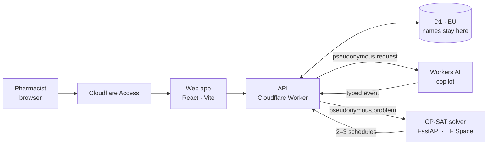

# pillbox

**AI-assisted staff scheduling for pharmacies. A CP-SAT solver builds the schedule; an LLM
copilot turns "Sam is sick until Thursday" into feasible options you pick with one click.**

[Why](#why) · [How it fits together](#how-it-fits-together) · [How it works](#how-it-works) · [Stack](#stack) · [Privacy](#privacy-by-design) · [Roadmap](ROADMAP.md)

> **Status: M0, foundations.** Rewrite of a production prototype used daily by an independent
> pharmacy in France. Docs, decisions and the issue → PR workflow are in place; code starts with
> the monorepo scaffold. See [ROADMAP.md](ROADMAP.md).

## Why

A pharmacy can never be left without a pharmacist, never with a single person on site, and
every employee must hit their exact contract hours on a two-week A/B cycle. Re-planning by hand
when someone calls in sick takes an hour. pillbox does it in seconds and never breaks a hard
rule.

## How it fits together

The API is the only component that knows real names. The copilot and the solver only ever see
IDs like `E3` ([ADR-007](DECISIONS.md#adr-007-pseudonymize-before-any-call-that-leaves-the-api)).

## How it works

1. Describe what happened, in plain French.
2. The copilot asks only for what is missing (how long? half day?).
3. The solver produces 2–3 schedules with different trade-offs (fewest changes, balanced hours,
   no overtime).
4. You pick one; it is applied, and can be undone.

The LLM never writes a schedule. It extracts structured events and explains results. Every
schedule comes from the solver
([ADR-003](DECISIONS.md#adr-003-the-llm-is-an-interface-never-the-optimizer)).

## Stack

| Layer | Tech | Hosting (free tier) |
| --- | --- | --- |
| Web | React, TypeScript, Vite | Cloudflare Pages |
| API | Cloudflare Worker, D1 (SQLite) | Cloudflare Workers |
| LLM | Workers AI (open-weight models), AI Gateway | Cloudflare |
| Solver | Python, FastAPI, Google OR-Tools CP-SAT | Hugging Face Space |
| Auth | Cloudflare Access | Cloudflare Zero Trust |

Everything runs on free tiers ([ADR-009](DECISIONS.md#adr-009-free-tiers-only)).

## Privacy by design

Real staff data never enters this repository, the LLM or the solver. Names stay in D1 behind
Cloudflare Access; everything else sees pseudonymous IDs. CI fails if a real name or the
pharmacy's identity appears anywhere in the code or commit messages. Details in
[DECISIONS.md](DECISIONS.md) (ADR-005 to ADR-008).

## Development

Humans and coding agents follow the same rules: [AGENTS.md](AGENTS.md) for the workflow and
hard rules, [DECISIONS.md](DECISIONS.md) for the ADRs, [CONTRIBUTING.md](CONTRIBUTING.md) for
the issue → PR flow.

## License

[MIT](LICENSE)
